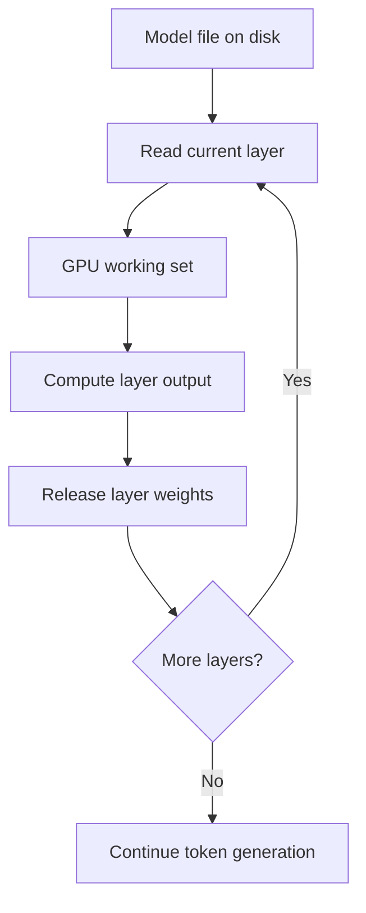

## The working-set idea

A conventional execution path may load all model weights before inference. Layer streaming instead brings the current layer into the GPU working set, computes with it, releases its buffers, and then advances.

## Expected advantages

The approach is intended to reduce **resident weight memory** by avoiding full-model GPU residency. That may make a larger model feasible on a constrained GPU, but feasibility depends on the full working set and on how tensors are transferred and reused.

## Tradeoffs to measure

- Repeated disk reads or host-memory staging
- Host-to-device transfer volume and synchronization
- Buffer allocation and reuse across layers
- Latency added to each token step
- Interaction with activations and KV cache

## Evaluation plan

Compare a full-residency baseline with the streaming runtime on the same hardware and model. Record peak GPU memory, prompt-processing throughput, generation throughput, and context length. Publish the exact run setup alongside the results.

No comparative measurements have been recorded in this note yet.
