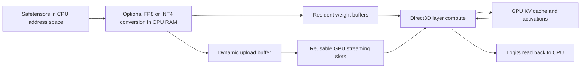

## Why stream?

Qwen3-8B's BF16 weights exceed the available GPU memory. The runtime keeps as many **complete layers** resident as its budget estimate permits and transfers the remaining layers through reusable GPU buffers. A resident layer is not uploaded again for each token; a nonresident layer must be made available again as its streaming slots are reused. The output head can also be streamed.

The sequence is:

The dynamic upload buffer is mapped for CPU writing and copied to a reusable GPU slot. Direct3D and the driver manage its physical placement. The original weights are memory-mapped; Windows may page them in from storage. Quantized matrices are produced in host memory at load time. Input embeddings are read from the BF16 CPU mapping, converted to FP32 and uploaded. The GPU computes the logits; the CPU reads them back for token selection.

## What stays in GPU memory?

- The selected resident layer matrices and, when it fits, the output head.
- Per-layer normalization weights and, for Qwen2.5, Q/K/V biases.
- FP32 key/value caches, allocated for the configured maximum context, plus activations, logits, attention buffers and streaming slots.
- Other runtime and driver resources, including transfer/staging allocations, whose actual placement and overhead depend on Direct3D.

The input embedding matrix remains in the CPU mapping. With tied Qwen2.5 weights, the GPU output head is still a separate representation of that matrix. The runtime's reported residency counts the seven large projection matrices in each layer; it does not mean every model tensor resides in VRAM.

The planner targets 80% of reported dedicated VRAM by default: approximately $5.83 \times 0.8 = 4.66$ GiB on the test GPU. It first subtracts its tracked streaming slots, KV caches and scratch buffers, then places whole layers in order. Only after all layers fit does it attempt to make the output head resident. This is a **planning estimate**, not a hard cap on total GPU usage: small norm/bias buffers, dynamic upload/staging resources, driver overhead and other processes are not all included in that sum. Allocation failures and other workloads can change the outcome.

## Quantization, size and observed residency

The table combines two different kinds of numbers:

1. **Matrix storage** is calculated from the actual tensor shapes and the runtime's packed layout. It is the combined size of all layer projection matrices plus the output head, whether or not they are resident. FP8 per-row scales and INT4 BF16 group scales and padding are included. For INT4 the head remains FP8. This is **not** total GPU use, CPU memory use, or a full model file size: CPU embeddings, small norm/bias tensors, KV cache, activations, slots and driver overhead are excluded.
2. **Resident layers and streaming** are the runtime's reported values from the 18 November 2026 runs on the NVIDIA GTX 1660 Ti Max-Q, at context 2,048 and an 80% budget. `+ head` means the output head was resident. Streaming is the runtime's calculated nominal weight volume per decode step, rounded to 0.01 GiB; it is not an independent transfer measurement.

One GiB is $2^{30}$ bytes. `—` means group size does not apply.

| Model | Precision | INT4 group | Matrix storage (GiB) | Resident | Reported streamed per token (GiB) |
| --- | --- | ---: | ---: | --- | ---: |
| Qwen2.5-0.5B | BF16 | — | 0.9201 | 24/24 + head | 0.00 |
| Qwen2.5-0.5B | FP8 | — | 0.4617 | 24/24 + head | 0.00 |
| Qwen2.5-0.5B | INT4 | 32 | 0.3148 | 24/24 + head | 0.00 |
| Qwen2.5-0.5B | INT4 | 64 | 0.3044 | 24/24 + head | 0.00 |
| Qwen2.5-0.5B | INT4 | 128 | 0.2992 | 24/24 + head | 0.00 |
| Qwen2.5-1.5B | BF16 | — | 2.8751 | 28/28 + head | 0.00 |
| Qwen2.5-1.5B | FP8 | — | 1.4405 | 28/28 + head | 0.00 |
| Qwen2.5-1.5B | INT4 | 32 | 0.9043 | 28/28 + head | 0.00 |
| Qwen2.5-1.5B | INT4 | 64 | 0.8662 | 28/28 + head | 0.00 |
| Qwen2.5-1.5B | INT4 | 128 | 0.8471 | 28/28 + head | 0.00 |
| Qwen3-8B | BF16 | — | 14.0967 | 10/36 | 10.50 |
| Qwen3-8B | FP8 | — | 7.0541 | 21/36 | 3.28 |
| Qwen3-8B | INT4 | 32 | 4.2188 | 36/36 | 0.58 |
| Qwen3-8B | INT4 | 64 | 4.0167 | 36/36 | 0.58 |
| Qwen3-8B | INT4 | 128 | 3.9156 | 36/36 + head | 0.00 |

For example, Qwen3-8B INT4 group 32 uses about 4.2188 GiB for these matrices, including its 0.5802 GiB FP8 head. All layers fit in the planned budget but the head does not, so the head is streamed. With group 128 the calculated matrix total falls to 3.9156 GiB and the head also fit **in this run**. That does not imply a better quality result: see the [quantization equations and quality experiment](/research/transformers-with-direct3d-compute-shaders/).

## Why transfer costs repeat

During single-token decoding, each new token passes through all layers again. When a layer's weights are not resident, their streaming slots are normally overwritten as other layers execute and the layer must be uploaded again for the next token. If the head is not resident, it likewise generally needs to be uploaded for each new logits calculation. Slot reuse, chunking and the last contents of a slot affect the exact number of copies; the table's reported volume is an estimate, not a byte counter. The KV cache avoids recomputing previous keys and values, but does **not** eliminate the weight transfers for the new token.

With a discrete GPU the host-to-device path typically uses PCI Express. As an illustration only, transferring 10.50 GiB at an assumed sustained 10 GiB/s takes about 1.05 seconds before considering computation, other transfers and synchronization. This is not a measured bus speed or an exact latency prediction; overlap, caching, driver behavior and workload change the result. More streamed data can make bandwidth and synchronization dominate, but the actual bottleneck must be measured.

Prompt prefill differs: the engine processes up to 32 prompt tokens in a batch, layer by layer, so a streamed layer can be reused across that batch. Multi-chunk matrices can require additional uploads as slots are reused. The reported per-token decode volume should not be interpreted as measured prompt-prefill traffic.

## Remaining work

These are calculated sizes and runtime residency reports, not a full memory profiler trace. A controlled comparison should independently measure peak GPU and host memory, actual PCIe traffic, prompt throughput and decode throughput at multiple context lengths, and repeat runs under comparable system load.
