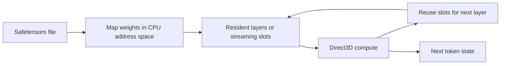

## The problem came before the runtime

I wanted to run language models locally on a Windows Surface Book with a 6 GB NVIDIA GPU. The available paths made that harder than it first appeared: a Python environment, CUDA and cuDNN dependencies, an ONNX conversion workflow, or execution somewhere in the cloud.

Each of those options can be useful. But they also left a question I wanted to investigate: **could I build a smaller, more direct path from model weights to GPU execution?**

## A different boundary

The initial premise was not to invent a new transformer. The interesting systems question was how to work within a tight memory budget:

- Read weights directly from Safetensors files.
- Keep layers resident when they fit and stream the remaining weight matrices.
- Execute the layer using Direct3D compute shaders.
- Manage the growing KV cache as part of the same memory budget.

The aim is an end-to-end C# runtime for Windows, with fewer conversion steps and an execution path that can be inspected one layer at a time.

## Building the inference engine

The work proceeded in three stages:

1. **Loader first.** Read the Safetensors headers and model configuration, map the original weights into the process address space, and resolve the tensor names, shapes, types and offsets needed by each layer. This made it possible to access original BF16 data without converting the model to another file format. See [the loader note](/research/reading-safetensors-without-hugging-face/).
2. **Prompt prefill next.** Tokenize the prompt and run its tokens through the transformer, filling each layer's key/value cache. The current engine processes up to 32 prompt tokens in a batch, organized layer by layer so streamed weights can be reused within the batch.
3. **Token loop last.** Use the last prompt logits to choose a token, feed generated tokens back through the model one at a time, append their keys and values to the cache, and stop on an end token or the configured output limit. The interactive loop retains the conversation until `/reset` or the context limit.

Subsequent work added Qwen2.5 family differences, configurable FP8 and INT4 weights, and measured the resulting [quality](/research/transformers-with-direct3d-compute-shaders/) and [residency](/research/layer-streaming-for-large-language-models/). The GPU does the transformer operations; tokenization, sampling, initial weight conversion and orchestration are CPU-side.

The application now uses an `IInferenceProvider` with three operations: `LoadModel` creates a disposable context, `DoPreFill` processes each prompt, and `GetNextToken` supplies text fragments until it returns `null`. A fragment can be empty when a token does not complete a UTF-8 character. The context retains the KV cache and conversation state between prompts; `/reset` clears that state, and disposing the context releases the model and GPU resources. This interface refactoring was performed after the published quality measurements.

## Inference in action

These recordings show the console generating text alongside the GPU performance view in Windows Task Manager. They illustrate individual runs, not a controlled throughput benchmark.

<figure class="inference-video">
  <video controls preload="none" playsinline aria-label="Qwen2.5-0.5B console generation and GPU performance">
    <source src="/videos/Qwen2.5-0.5B.mp4" type="video/mp4">
    Your browser cannot play this video.
  </video>
  <figcaption><strong>Qwen2.5-0.5B</strong> · 56 seconds · <a href="/videos/Qwen2.5-0.5B.mp4">Open video</a></figcaption>
</figure>

<figure class="inference-video">
  <video controls preload="none" playsinline aria-label="Qwen2.5-1.5B console generation and GPU performance">
    <source src="/videos/Qwen2.5-1.5B.mp4" type="video/mp4">
    Your browser cannot play this video.
  </video>
  <figcaption><strong>Qwen2.5-1.5B</strong> · 1 minute 16 seconds · <a href="/videos/Qwen2.5-1.5B.mp4">Open video</a></figcaption>
</figure>

<figure class="inference-video">
  <video controls preload="none" playsinline aria-label="Qwen3-8B console generation and GPU performance">
    <source src="/videos/Qwen3-8B.mp4" type="video/mp4">
    Your browser cannot play this video.
  </video>
  <figcaption><strong>Qwen3-8B</strong> · 1 minute 52 seconds · <a href="/videos/Qwen3-8B.mp4">Open video</a></figcaption>
</figure>

## Memory is more than model weights

Model weights are only one part of the inference working set. Activations and the KV cache also consume memory, and the cache grows as the context grows. A useful starting point for the investigation is:

$$
M_{\mathrm{working}} =
M_{\mathrm{weights,resident}} +
M_{\mathrm{activations}} +
M_{\mathrm{KV}} +
M_{\mathrm{runtime}}
$$

Layer streaming is intended to change the resident-weights term. It does not remove the other terms, and it may introduce data-transfer costs. Those effects need to be measured rather than assumed away.

## The working hypothesis

Keeping only some weights resident reduces the amount that must remain in GPU memory. The tradeoff is coordinating transfers and compute for the remaining layers.

The question is not simply whether streaming uses less memory. It is whether the memory savings are useful on the target device while preserving an acceptable end-to-end generation path.

## What remains to be demonstrated

This is a research prototype, not a claim that every model or workload will benefit. The published small quality experiment and runtime residency reports are initial observations, not a comprehensive benchmark. Further work includes independently checking tensor operations and measuring peak memory, actual transfers and prompt and generation throughput under controlled conditions.
