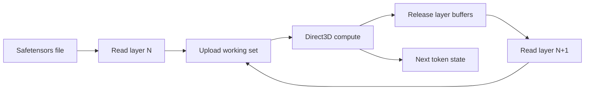

## The problem came before the runtime

I wanted to run language models locally on a Windows Surface Book with a 6 GB NVIDIA GPU. The available paths made that harder than it first appeared: a Python environment, CUDA and cuDNN dependencies, an ONNX conversion workflow, or execution somewhere in the cloud.

Each of those options can be useful. But they also left a question I wanted to investigate: **could I build a smaller, more direct path from model weights to GPU execution?**

## A different boundary

The initial premise was not to invent a new transformer. The interesting systems question was how to work within a tight memory budget:

- Read weights directly from Safetensors files.
- Load only the tensors needed for the current layer.
- Execute the layer using Direct3D compute shaders.
- Manage the growing KV cache as part of the same memory budget.

The aim is an end-to-end C# runtime for Windows, with fewer conversion steps and an execution path that can be inspected one layer at a time.

## Memory is more than model weights

Model weights are only one part of the inference working set. Activations and the KV cache also consume memory, and the cache grows as the context grows. A useful starting point for the investigation is:

$$
M_{\mathrm{working}} =
M_{\mathrm{weights,resident}} +
M_{\mathrm{activations}} +
M_{\mathrm{KV}} +
M_{\mathrm{runtime}}
$$

Layer streaming is intended to change the resident-weights term. It does not remove the other terms, and it may introduce data-transfer costs. Those effects need to be measured rather than assumed away.

## The working hypothesis

Loading one layer at a time may reduce the amount of model weight data that must remain resident on the GPU. The tradeoff is additional coordination: reading, transferring, scheduling and releasing tensors around each layer.

The question is not simply whether streaming uses less memory. It is whether the memory savings are useful on the target device while preserving an acceptable end-to-end generation path.

## What remains to be demonstrated

This is a research prototype, not a claim that every model or workload will benefit. The next steps are to validate tensor loading and operations, establish a reproducible baseline, and record peak memory and throughput for prompt processing and generation.

No performance comparison is published here yet. The measurements should make the limits and tradeoffs visible, including the cost of moving weights layer by layer.
